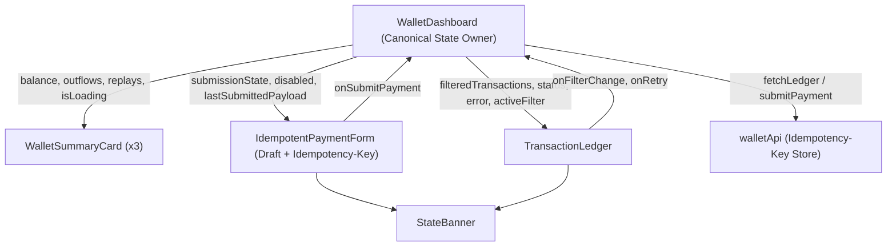

# Day 5 – React State & Component Design (Digital Wallet Simulator)

React UI prototype for a **Digital Wallet Simulator** featuring a canonical transaction ledger, idempotent payment submission (`Idempotency-Key`), explicit loading/empty/error states, and clear state ownership across four reusable components.

## Reusable Components

1. **`WalletSummaryCard`** (`src/components/WalletSummaryCard.jsx`): Purely presentational KPI card displaying Available Balance, Settled Outflows, and Idempotent Replays Caught, with skeleton loading support.
2. **`IdempotentPaymentForm`** (`src/components/IdempotentPaymentForm.jsx`): Controlled-submission form managing only ephemeral draft inputs (`recipient`, `amountInput`, `memo`, `idempotencyKey`, `simulateNetworkFault`). Retains the same `Idempotency-Key` on network failure for safe retries and rotates it only on `201 Created`.
3. **`TransactionLedger`** (`src/components/TransactionLedger.jsx`): Filterable ledger view (`All`, `Debits`, `Credits`, `Replayed`) rendering loading skeletons, empty states, error banners, and settled transaction rows with replay badges.
4. **`StateBanner`** (`src/components/StateBanner.jsx`): Accessible status banner (`loading`, `empty`, `error`, `success`, `info`) with `role="status"` / `role="alert"` and optional recovery CTA.

## State Ownership

| Owner | State | Why It Lives Here |
| --- | --- | --- |
| `WalletDashboard` (`src/App.jsx`) | `wallet` (`balanceCents`, `transactions`), `ledgerStatus`, `ledgerError`, `scenario`, `activeFilter`, `submissionState`, `lastSubmittedPayload` | Single source of truth so KPI cards, payment form disablement, and ledger rows stay synchronized without duplicate copies. |
| Derived via `useMemo` in `WalletDashboard` | `filteredTransactions`, `totalDebitsCents`, `totalReplays` | Computed directly from `wallet.transactions` and `activeFilter` to avoid state drift. |
| `IdempotentPaymentForm` (`src/components/IdempotentPaymentForm.jsx`) | `recipient`, `amountInput`, `memo`, `idempotencyKey`, `simulateNetworkFault` | Ephemeral form-draft state stays local so keystrokes don't re-render the ledger; `idempotencyKey` only rotates after a new `201 Created` settlement. |
| `WalletSummaryCard`, `TransactionLedger`, `StateBanner` | Stateless (`props`-driven) | Maximizes reusability and deterministic unit testing. |

## Loading, Empty, and Error States

- **Loading**: Initial mount or scenario switch sets `ledgerStatus = 'loading'`, displaying skeleton metrics in `WalletSummaryCard` and skeleton rows + `StateBanner(variant="loading")` in `TransactionLedger`.
- **Empty**:
  - Empty wallet (`scenario = 'empty'`): `TransactionLedger` renders `StateBanner(variant="empty")` with a recovery button (`Load Normal Ledger`), and `IdempotentPaymentForm` stays disabled until a ledger syncs.
  - Empty filter result (e.g., `Replayed` filter with 0 matches): `TransactionLedger` shows `No Matching Entries` with a `Show All Entries` CTA.
- **Error**:
  - Ledger fetch failure (`scenario = 'error'`): `TransactionLedger` renders `StateBanner(variant="error")` with `Retry Sync`.
  - Payment failure (`503 GATEWAY_TIMEOUT`, `402 INSUFFICIENT_FUNDS`, or `422 IDEMPOTENCY_KEY_REUSE_CONFLICT`): `IdempotentPaymentForm` renders an alert banner while **preserving the exact `Idempotency-Key`** so retrying never double-charges.

## Component & Data-Flow Diagram



## Idempotent Payment API Example

### 1. First Request (Network Timeout or Initial Settlement)

```http
POST /api/v1/wallet/payments HTTP/1.1
Content-Type: application/json
Idempotency-Key: pay_7f3a91c20b4e

{
  "recipient": "Vertex Energy Corp",
  "amountCents": 4500,
  "memo": "Grid telemetry invoice #88"
}
```

Response (`201 Created`):

```json
{
  "outcome": "created",
  "balanceCents": 245500,
  "transaction": {
    "id": "tx_9004",
    "type": "debit",
    "counterparty": "Vertex Energy Corp",
    "amountCents": 4500,
    "idempotencyKey": "pay_7f3a91c20b4e",
    "replayCount": 0
  }
}
```

### 2. Safe Client Retry with Same `Idempotency-Key` and Payload

Response (`200 OK` — no second debit):

```json
{
  "outcome": "idempotent_replay",
  "balanceCents": 245500,
  "transaction": {
    "id": "tx_9004",
    "type": "debit",
    "counterparty": "Vertex Energy Corp",
    "amountCents": 4500,
    "idempotencyKey": "pay_7f3a91c20b4e",
    "replayCount": 1
  }
}
```

### 3. Key Reuse Conflict (Same Key, Modified Amount/Recipient)

Response (`422 Unprocessable Entity`):

```json
{
  "error": {
    "code": "IDEMPOTENCY_KEY_REUSE_CONFLICT",
    "message": "Idempotency-Key \"pay_7f3a91c20b4e\" was already used for a different recipient or amount."
  }
}
```

## Run & Verify Locally

```bash
npm install
npm test
npm run build
npm run dev
```

## Verification Evidence

- **`npm test` (`vitest run`)**: **5/5 tests passed** (`src/App.test.jsx`):
  - Initial loading skeleton -> settled canonical balance (`$2,500.00`) and ledger rows.
  - Empty wallet state (`No Transactions Yet` + recovery CTA) and `Credits` tab filtering.
  - Error state (`Could Not Load Transaction Ledger` alert + `Retry Sync`).
  - Simulated `503` timeout preserves `Idempotency-Key`, retry settles once (`201 Created`, `$2,455.00`), and replay returns `200 OK` (`Replayed x1`) without double-debiting.
  - Reusing an existing `Idempotency-Key` with modified payload triggers `422 IDEMPOTENCY_KEY_REUSE_CONFLICT`.
- **`npm run build` (`vite build`)**: Built 35 modules cleanly into `dist/` in 247ms.
